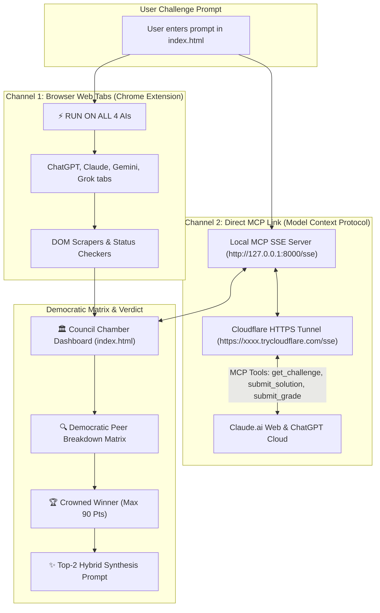

# 🚀 GEN COUNCIL — Project State & Architectural Handoff Document

> [!NOTE] 
> This document preserves the complete state, file paths, protocol architecture, commercial multi-page design (inspired by Turion Space), and open-source roadmap for **GEN COUNCIL** (formerly Sovereign AI Council).

---

## 📂 Project Files & Locations

All code lives locally on your Windows PC with **zero external downloads or third-party software**:

| Component | File Path | Description |
|---|---|---|
| **Council Chamber** | [`index.html`](file:///C:/Users/prave/.gemini/antigravity/scratch/ai-council/index.html) | Main web dashboard (Dual Extension + MCP banner, Live Trackers, Matrix, Scorecard, Winner). |
| **Local MCP Server** | [`server.py`](file:///C:/Users/prave/.gemini/antigravity/scratch/ai-council/server.py) | Python Model Context Protocol (MCP) server running SSE at `http://127.0.0.1:8000/sse` with REST API, static web serving, auto Cloudflare tunnel, and auto-clipboard copying. |
| **1-Click MCP Launcher** | [`start_mcp_council.bat`](file:///C:/Users/prave/.gemini/antigravity/scratch/ai-council/start_mcp_council.bat) | 1-click Windows batch launcher to start the MCP server, launch the HTTPS tunnel, copy the URL to clipboard, and open the Chamber dashboard. |
| **Extension Manifest** | [`manifest.json`](file:///C:/Users/prave/.gemini/antigravity/scratch/ai-council/extension/manifest.json) | Manifest V3 extension with `<all_urls>`, `tabs`, `scripting`, and `storage` permissions. |
| **Service Worker** | [`background.js`](file:///C:/Users/prave/.gemini/antigravity/scratch/ai-council/extension/background.js) | Dynamic active-tab resolution, parallel injectors, multi-strategy scrapers, and status checkers. |
| **Extension Relay** | [`bridge.js`](file:///C:/Users/prave/.gemini/antigravity/scratch/ai-council/extension/bridge.js) | Content script relaying `window.postMessage` between `index.html` and the extension. |
| **Desktop Launcher** | [`open_council.bat`](file:///C:/Users/prave/.gemini/antigravity/scratch/ai-council/open_council.bat) | 1-click Windows batch launcher to launch the dashboard in Edge/Chrome. |

---

## ⚙️ Dual-Channel Architecture (Browser Extension + Public MCP Tunnel)

---

## 🔌 Connection Indicator & Per-Seat Delivery Modes

The Council Chamber header now features an interactive **Delivery Mode & Connection Indicator** badge for each seat:

- **Interactive Seat Badges**:
  - `🔄 Auto`: Dynamically routes prompt via MCP if the model has an active connector heartbeat (`< 10m`), or via Browser Tab extension otherwise.
  - `⚡ MCP Link`: Forces delivery and responses through the MCP Server stream (`/mcp`).
  - `🌐 Browser Tab`: Forces delivery and scraping through open browser tabs via the Chrome/Edge extension bridge.
- **Click to Cycle**: Click any AI's mode badge in the Chamber header to instantly cycle: `Auto ➔ Force MCP ➔ Force Tab ➔ Auto`. Mode changes are persisted to the server at `/api/set_model_mode`.
- **MCP Active Indicator**: When Claude (or any AI) connects to the MCP tunnel, the badge glows green (`⚡ MCP Active`) and readiness cards transition from "Waiting..." directly to `✅ MCP Received` upon solution submission.

---

## 🛠️ MCP Tools Exposed

Any AI model linked to the MCP Server URL automatically receives these 7 tools:

1. **`council_register_seat(model_name)`**: Handshakes and registers the seat as MCP active.
2. **`council_get_challenge`**: Fetches the active challenge prompt and current stage instructions.
3. **`council_submit_solution(model_name, solution)`**: Delivers the model's answer directly into the Council Chamber (zero DOM scraping needed).
4. **`council_get_peer_solutions(my_model_name)`**: Fetches peer models' answers for blind peer review (own model answer strictly excluded).
5. **`council_submit_peer_evaluation(my_model_name, target_peer_id, prompt_adherence, logic_and_accuracy, depth_and_completeness, critique)`**: Submits structured integers (1–10) and critique for a single model.
6. **`council_submit_all_evaluations(my_model_name, evaluations)`**: Submits evaluations for all peers in a single call (prevents models stopping after grading only 1 peer).
7. **`council_get_scoreboard`**: Reads current democratic scores, rankings, winner, and top-2 hybrid synthesis prompt.

---

## 🌐 Commercial Multi-Page Architecture (Turion Space Inspiration)

GEN COUNCIL is structured as a multi-page commercial website and platform:

1. **Fixed Global Navigation Bar (`.global-navbar`):**
   - **Logo:** `GEN COUNCIL` with live radar dot and `[CONSENSUS ENGINE]` badge.
   - **Navigation Links:** `01 // OVERVIEW`, `02 // CHAMBER`, `03 // PROTOCOL`, `04 // GET STARTED`, `05 // OPEN SOURCE`.
   - **Top Controls:** Aesthetic theme switcher (Aurora, Cyber, Royal, Synth), live MCP connection pill, and `[ ⚡ LAUNCH CHAMBER ]` button.
2. **Page Views:**
   - **`01 // OVERVIEW` (Commercial Landing Page):** Turion Space-style hero, giant `GEN COUNCIL` display title, tactical HUD telemetry bar, 4 bold stat counters (`4 Frontier Labs`, `90 Max Score`, `0 API Fees`, `100% Local-First`), cognitive problem statement, 3-pillar protocol overview, and universal deployment breakdown.
   - **`02 // CHAMBER` (The Working Deliberation Engine):** The full, interactive council application with Round 1 broadcast, Round 2 auto-debate, Round 3 democratic scorecard, live matrix, sample deliberation test, and crowned winner synthesis.
   - **`03 // PROTOCOL` (Mathematics & Rubric Specs):** The standardized 30-pt rubric breakdown (Adherence, Logic, Depth), consensus mathematical formula, tie-breaking hierarchy, and dual-channel mechanics.
   - **`04 // GET STARTED` (Universal Quickstart):** 3-minute guides for everyday users (extension), power users (MCP connector), and developers (local server), plus interactive FAQ.
   - **`05 // OPEN SOURCE` (Public Release & Roadmap):** Open source manifesto, MIT license, repository tree, and development roadmap (local Ollama/DeepSeek support, Discord bot, multi-turn debates).
3. **Commercial Footer (`.turion-footer`):**
   - Aerospace footer with corporate brand, quick links, and 2026 copyright.

---

## ⚠️ Important Protocol Note: Claude.ai Uses Streamable HTTP (`/mcp`)

* **Claude.ai Connector Protocol:** Claude's "Add custom connector" probes via `POST` using **Streamable HTTP** (`/mcp`), not legacy SSE (`/sse`). Passing a `/sse` URL caused a 405 error misdiagnosed as an auth failure.
* **Automatic Cloudflare HTTPS Tunnel:** When you double-click `start_mcp_council.bat`, it starts `server.py` with Streamable HTTP on `/mcp`, launches a Cloudflare tunnel (`https://xxxx.trycloudflare.com/mcp`), and **automatically copies the live `/mcp` URL to your Windows clipboard**.
* **Keep the Console Window Open:** If the console window is closed, the server and tunnel stop, and Claude will show *"Couldn't reach ai council"*.

---

## ⚡ 100% Automated Hands-Free Auto-Pilot Pipeline

GEN COUNCIL now includes a built-in state machine for completely hands-free deliberation:

1. **Auto-Pilot HUD & Switch:**
   - Active by default (`isAutoPilot = true`).
   - Chamber header displays a glowing indicator `[ ⚡ AUTO-PILOT: ACTIVE ]` and toggle switch `[ ⚡ Auto-Pilot: ON / OFF ]`.
2. **Step 1 ➔ Step 2 Automatic Transition:**
   - When all 4 models complete their initial responses, the Round 1 banner initiates a 2-second countdown (`⚡ Auto-advancing in 2s...`).
   - Automatically switches to Step 2, pulls answers from browser tabs / MCP, and automatically dispatches peer review prompts to all models with zero user clicks.
3. **Step 2 ➔ Step 3 Automatic Transition:**
   - Once all 4 models finish their peer reviews, the Round 2 banner initiates a 2-second countdown.
   - Automatically switches to Step 3, auto-extracts peer scores, populates the Democratic Peer Breakdown matrix, tallies the totals, crowns the official winner, generates the synthesis prompt, and gently displays the final verdict.
4. **Safety & Pause Guards:**
   - Users can pause or cancel the auto-transition at any time via the `[ Pause ]` button on the countdown banner or the `[ Auto-Pilot: ON/OFF ]` toggle.

